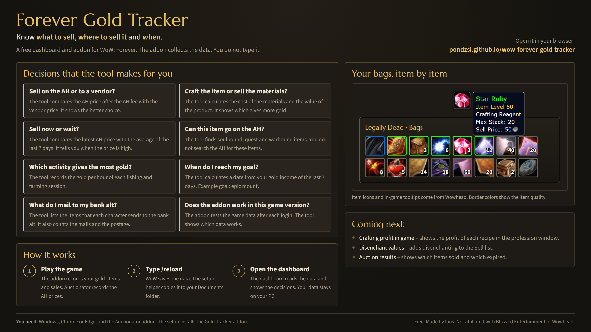

# Forever Gold Tracker

A local dashboard for gold, prices, crafting profit, professions and farming/fishing sessions in WoW: Forever.
Most data comes from the game by itself: the **Gold Tracker** addon (in this repo) and **Auctionator**.
Design and scope: [docs/v1-spec.md](docs/v1-spec.md).

**Overview page to share:** https://pondzsi.github.io/wow-forever-gold-tracker/demo/



## Setup (once)

1. **Auctionator** (required, for AH prices): install it from CurseForge or Wago.
2. **Gold Tracker addon**: copy the folder `addon\GoldTracker` into the game's AddOns folder:
   `World of Warcraft\<game version folder>\Interface\AddOns\GoldTracker`
   If the game says it is out of date, tick "Load out of date AddOns" on the character screen.
3. **Dashboard**: double-click `start-dashboard.bat`. It opens http://localhost:5173.
4. In the dashboard: **Sync & to-do → Choose WoW folder**, and pick your `World of Warcraft` folder.
   Use Chrome or Edge. When the browser asks, allow access on every visit.

## Daily use

- Play normally. The addon records gold, income/expenses, bags, bank, skills, recipes, AH sale mails and
  fishing sessions (they start on your first catch).
- For farming: `/gt start farming` and `/gt stop`.
- At the AH, run an Auctionator scan now and then. Its prices feed the dashboard.
- WoW saves addon data only on logout or reload. Type `/gt sync` to save now, then switch to the dashboard tab:
  it syncs by itself.
- **Sync & to-do** lists what still needs you, ranked High / Medium / Low.
- **Send to bank alt** lists what your other characters should mail to the bank alt. Choose the bank alt there once.

Other commands: `/gt status`, `/gt` (help).

## Your data

- Data is saved in your browser (IndexedDB) for `http://localhost:5173`.
- Always use the same browser and the same address, or you will see an empty dashboard.
- Clearing browser data deletes it. Use **Settings & backup → Download backup** regularly.
- The dashboard only reads `GoldTracker.lua` and `Auctionator.lua`. It never writes to the game folder.

## Money input

Any of these work: `12g 34s 56c`, `12g`, `50s`, `123456c`, or `12.3456` (gold).

## Development

```bash
npm test          # unit tests (money, profit, SavedVariables parser, importers, to-do list)
npm run typecheck # TypeScript check
npm run build     # production build into dist/
```

The addon's game API calls are written for the retail client that Forever runs on. They are not verified
in-game yet; every call is guarded so a missing API skips that data instead of breaking the addon.
